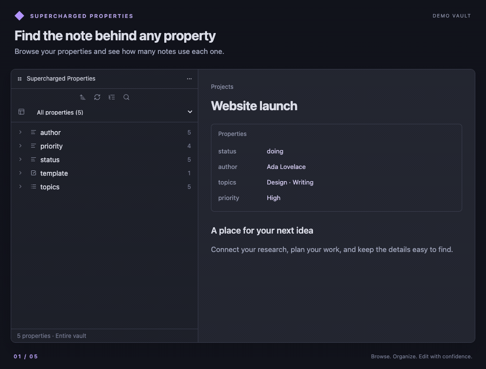
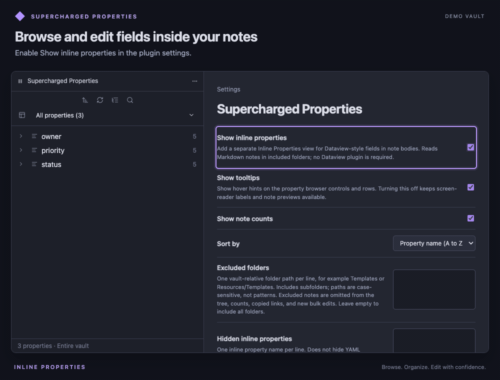
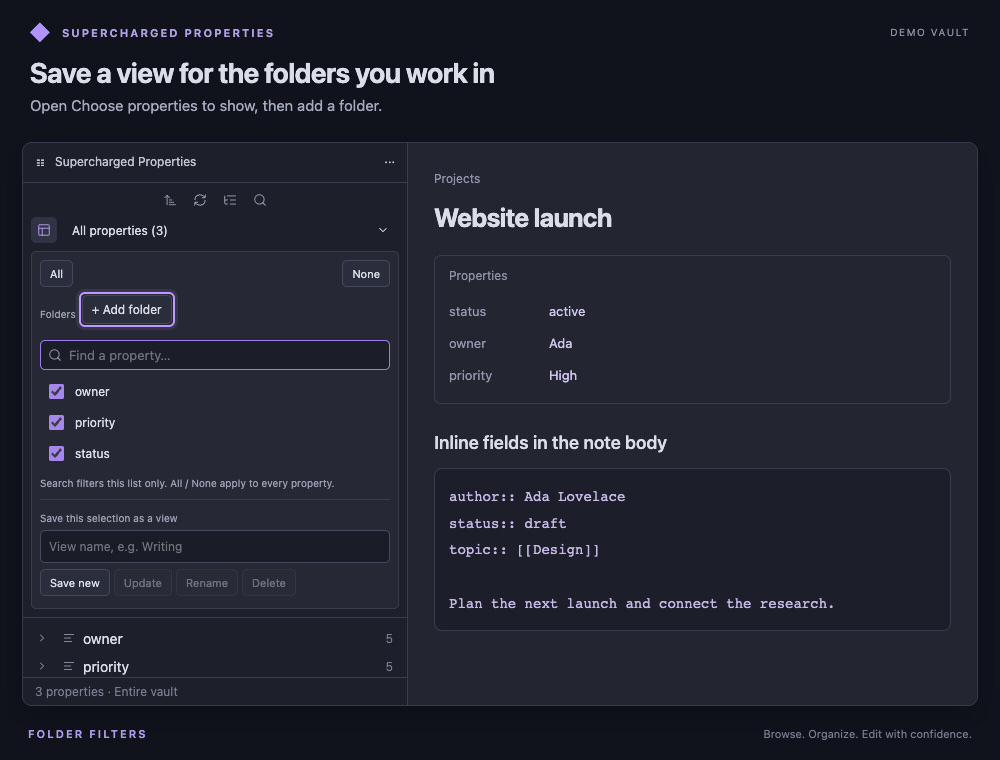
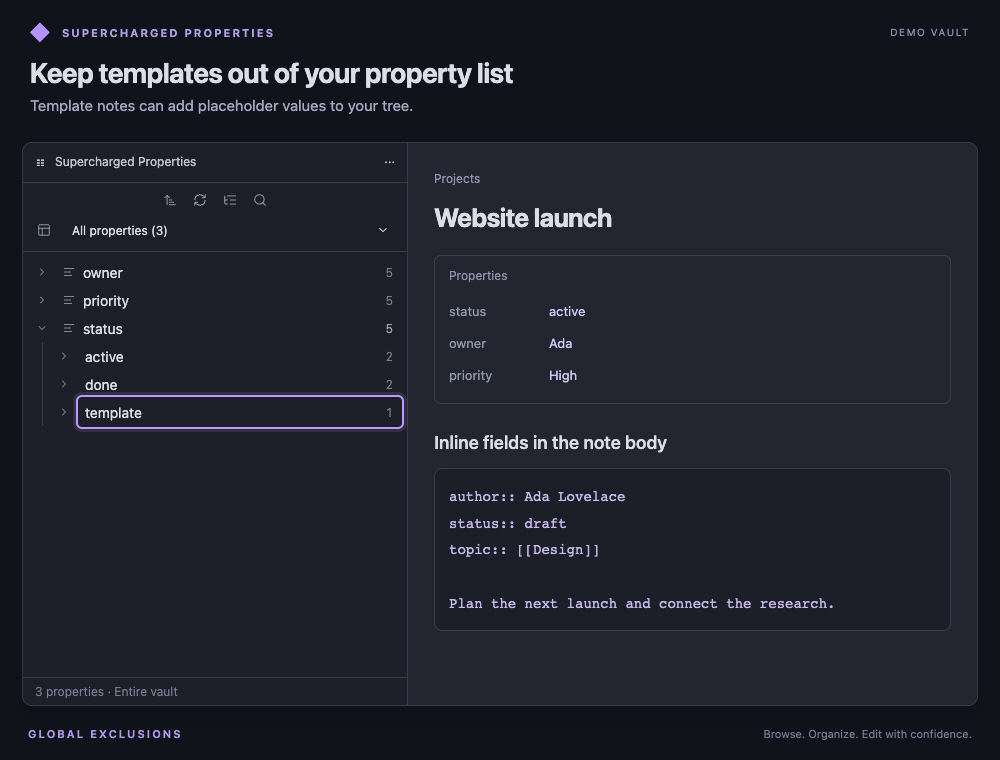
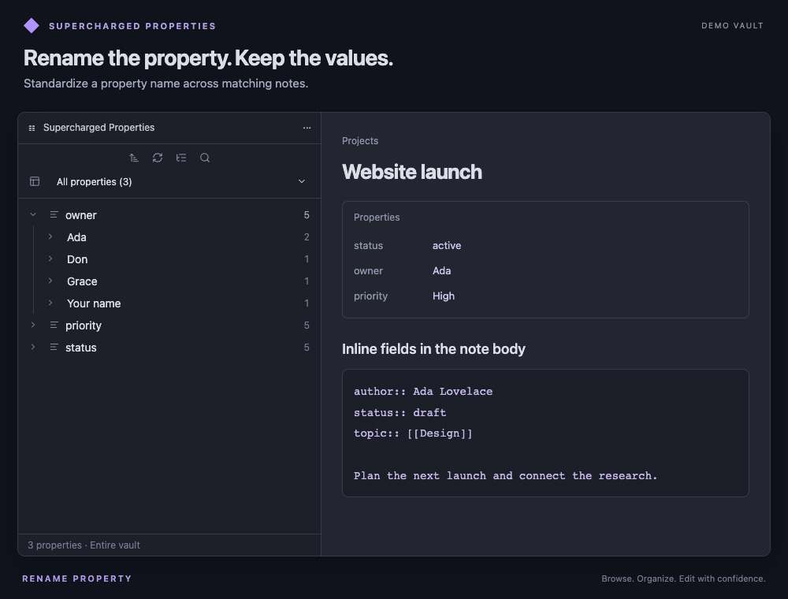
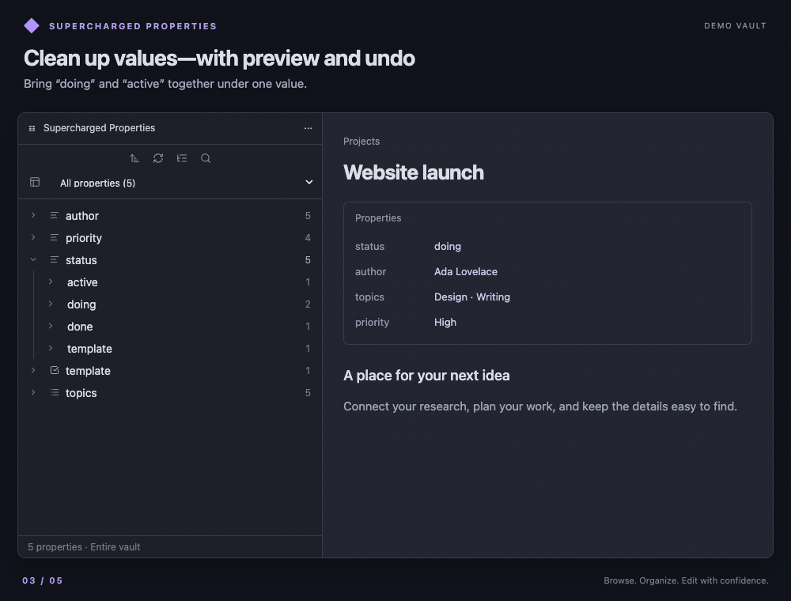

# Supercharged Properties

**Find notes by their properties and keep your vault's metadata consistent.**

Supercharged Properties brings your properties, their values, and the notes that use them into one browsable view. Find every note marked `doing`, explore notes by author or topic, and clean up inconsistent property names and values across many notes at once.

Choose the properties you want to see, save views for different projects, and exclude template folders to keep your results focused. Bulk edits show a preview before you confirm, with one-step undo for the last batch.

## Explore your notes

- **Browse properties → values → notes.** Expand a property to see its values, then open the notes that use them. Expand/collapse all preserves your search, active view, and Value filter. Individual branch arrows also work within search and filtered results. After Collapse all, expand properties → values → notes one level at a time. Property/value counts and the Value filter’s matching-note list update as you search.
- **Find what you need.** Search property names, values, note names, or folder paths. Open matching notes in Obsidian Search or copy their links.
- **See how properties are used.** Note counts show how common each property or value is. Type icons help distinguish text, lists, numbers, dates, and checkboxes.
- **Choose your order.** Sort alphabetically or by how many notes use a property or value. A–Z and Z–A order linked values and expanded notes by note filename, with natural numeric ordering.
- **Value filter.** Explore other properties only among notes sharing a value, with counts and note links recalculated for that group.
- **Stay up to date.** The view refreshes as your notes change.



Pins set in **All properties** are shared across YAML views. Pin or unpin inside a saved view to change only that view, without affecting All properties or other views.

## Browse inline properties

Enable **Settings → Supercharged Properties → Show inline properties**, then choose **Inline Properties** from the view dropdown. Browse a separate **property → value → notes** tree for fields written in note bodies:

```markdown
author:: AJ
[topic:: design]
(rating:: 4)
```

All properties and existing saved views continue to show YAML frontmatter. To save an inline view, choose **Inline Properties**, open **Choose properties to show**, select fields, enter a name, and choose **Save new**. The view picker opens downward with a scrollable list that fits the screen. Inline views appear as **Inline: Name** and have their own Update, Rename, and Delete controls. Inline browsing supports search, sorting, distinct-note counts, copied note links, and Value filters. Right-click or long-press inline rows to rename or delete a property, rename a value, or select several values to replace with one new text value. Edits require Preview changes and Confirm changes, with **Undo last inline property edit** available until reload. Inline pins and hidden properties are separate from YAML. Open in Search and Copy search query use text queries that may also match code examples. Excluded folders apply, and code, frontmatter, and comments are ignored. Fields in nested lists and indented list continuations are supported, including link values. Values are literal text; Dataview is not required. See [inline properties](docs/USER-GUIDE.md#inline-properties) for supported syntax and limits. Available in 1.5.0.



**Convert inline fields to YAML.** Move or copy inline fields into Obsidian properties from the inline property/value menu. Choose notes, handle existing values with Skip/Merge/Overwrite, and preview before confirming. Repeated fields become lists; conversion includes one-step session undo. [Conversion guide](docs/BULK-EDITING.md#convert-inline-properties-to-yaml).

## Folder counts in File explorer

Optionally show note counts beside folders in Obsidian’s File explorer. Choose counts for the current folder, all subfolders, or both; hide zeros or include attachments. Off by default. Counts include notes without properties and are independent of your selected property view and filters. [Setup and options](docs/USER-GUIDE.md#file-explorer-folder-counts). Available in the unreleased development version.

## Focus a view on folders

Open **Choose properties to show → + Add folder** to show notes from chosen folders and their subfolders. Manage folder chips or choose **Clear** inside that panel to broaden the view. Folder paths stay hidden while the panel is closed. Folder filters narrow counts, copied links, and edits, and combine with **Filter by Value**. Save them with YAML or Inline views—even when all properties are selected. Global **Excluded folders** always wins. [Folder filter guide](docs/USER-GUIDE.md#folder-filters).



## Explore notes sharing a value

Explore the rest of your metadata within a group of notes—for example, see which topics and authors occur among notes with `status: active`.

1. Right-click a value on desktop or long-press it on mobile, then choose **Filter by Value**.
2. Browse the remaining properties. Counts and note links now reflect only matching notes; the filter property stays in the bar above the tree.
3. Expand the **note count** to see the matching note names and folders. Click a name to open it, or Ctrl/Cmd-click to open a new tab. Larger groups offer **Show more** after the first 200 notes.
4. Choose **Clear** to remove the Value filter; any folder filter remains active.

On mobile and narrow panes, the property and value wrap so the full condition stays readable. The note-count and Clear buttons move together below the label when needed.


One filter is active per tab; choosing another replaces it. Notes entering or leaving that value update the results automatically. The filter is temporary and is not saved in a view. **Open in Search** and **Copy search query** remain vault-wide and do not include the value filter. See [Value filter](docs/USER-GUIDE.md#value-filter) for edit scope and examples. Available in **1.4.0**.

> Design and concept inspired by @[RedPandaLi|RedPandaLi's](https://github.com/RedPandaLi) idea of Scoped Properties.

## Keep your view focused

- **Choose properties.** Show only the fields relevant to your current work.
- **Save views.** Save property selections and folder filters as views such as Writing, Projects, or Reading, and switch between them.
- **Filter by folders.** Limit a view to selected folders and their subfolders. Counts, copied links, and edits follow that scope.
- **Pin and hide.** Keep frequently used properties at the top and hide fields you do not need to see.
- **Exclude folders.** Leave templates, drafts, or other folders out of the property list and counts. Exclusions include subfolders and also apply to new bulk edits.




## Change selected notes

Update one note or several notes under the same property. For example, move selected tasks from `status: todo` and `status: active` to `status: closed`.

1. Right-click a note on desktop or long-press it on mobile.
2. Choose **Change status…** (the action uses your property's name). To edit several notes, choose **Select notes…**, select the notes, then choose **Change status…** in the selection bar.
3. Choose the change, review the before/after preview, and confirm.

| Property type | What you can change |
| --- | --- |
| Text | Choose an existing value or enter new text. |
| Number | Set a number, such as a rating or estimate. |
| Checkbox | Set checked or unchecked. |
| Date / Date & time | Choose a date or local date and time. |
| List | Add or remove multiple text or number items while keeping the other items. |
| aliases / cssclasses | Add or remove text list items. |

**Set empty (keep property)** clears a scalar value while keeping its key. **Remove property** deletes the entire key and value from the selected notes, including every item in a list. Removing individual list values leaves an empty list if the last item is removed. Selected-note editing is unavailable for tags.

Selection shows checkboxes and highlighted rows on desktop and mobile. On desktop, **Alt/Option-click** toggles notes and **Shift-click** adds a displayed range. On mobile, use the checkboxes or tap rows in selection mode. You can select notes from different value groups under the same property. The mobile dialog keeps its actions above the keyboard.

Only the selected notes are changed. Review the preview before applying; **Undo last property edit** restores the last successful batch. See [changing selected notes](docs/NOTE-VALUE-EDITING.md) for examples, supported values, and selection behavior.


## Clean up properties across notes

Right-click a property or value to make changes across matching notes:

| Action | Example |
| --- | --- |
| Rename a property | Change `author` to `authors` while keeping each note's value. |
| Delete a property | Remove `deprecated` from every note that still has it. |
| Rename a value | Change `status: in-progress` to `status: active`. |
| Delete a value | Remove `obsolete` from `status` values and list entries. |
| Merge values | Combine `doing` with an existing `active` value. |
| Convert text to a link | Change `Ada Lovelace` to `[[Ada Lovelace]]`. |
| Split text into a list | Turn `research, writing, editing` into three list items. |

**Split into list** is available only for text values under Text properties. It is not offered for List, Number, Checkbox, Date, Date & Time, tags, aliases, or cssclasses.

Each edit shows the affected notes before you confirm. Property-name and deletion conflicts, and changes made since the preview, are skipped rather than overwritten. Browsing and organizing the view do not change your notes.

Bulk edits apply to matching notes in included folders. An active **Value filter** narrows value edits, property renames, and property deletions to that group of notes. Tree search and saved views do not further narrow the affected notes. Review the preview before confirming.





### Undo and edit limits

Use **Supercharged Properties: Undo last property edit** to undo the last successful batch. Undo preserves later edits by skipping conflicting values, including property keys recreated after a deletion. It is available until the plugin reloads or another successful batch replaces it. Deleting a property preserves your saved views and selections, so they still apply after undo.

Edits can change property formatting, including YAML comments and quoting; undo restores names and values, not the original formatting. Renaming a property does not update its configured type, templates, or queries that reference its old name. See the [editing guide](docs/BULK-EDITING.md) and [property-renaming guide](docs/PROPERTY-RENAMING.md) for details.

## Get started

1. Enable **Supercharged Properties** in Obsidian's community plugin settings.
2. Click its ribbon icon, or run **Supercharged Properties: Open sidebar** or **Open in tab** from the command palette.
3. Expand a property, then a value, to browse its notes.
4. Use **Choose properties to show** to select fields and save a view.

To exclude templates, open **Settings → Supercharged Properties → Excluded folders** and enter one folder path per line:

```text
Templates
Resources/Templates
```

Use paths relative to your vault, with matching capitalization. `Templates` excludes its subfolders but does not exclude `Templates Archive`. Changes take effect immediately. Obsidian's core Search is separate and can still return excluded notes.

## Mobile use

Version 1.2.1 improves saved-view controls on small screens: the name field and action buttons appear above the property list, the picker scrolls when space is limited, and it adjusts to the visible area above the keyboard. Opening the picker does not automatically open the keyboard. After typing a new view name, tap **Save new** or use **Done/Enter** to save; a successful save dismisses the name-field keyboard.

When choosing properties, **All** and **None** keep the view name you have typed on both desktop and mobile. Saving All reports that the default view already exists; saving None asks you to select at least one property. The built-in **All properties** view cannot be deleted or renamed. These saved-view improvements are included in 1.2.1.

## Settings

| Setting | What it does |
| --- | --- |
| Show tooltips | Show hover hints in the property browser; enabled by default. |
| Hidden inline properties | Hide inline property names without affecting YAML. |
| Show inline properties | Add the separate Inline Properties view; disabled by default. |
| Show note counts | Show how many distinct notes use each property or value. |
| Sort by | Choose alphabetical order or note frequency. |
| Excluded folders | Omit selected folders and their subfolders from the view and new bulk edits. |
| Hidden properties | Hide named properties; remove a name here to show it again. |

## Requirements and installation

Works on desktop and mobile with **Obsidian 1.7.2 or later**. The core **Search** plugin is needed only for **Open in Search**.

If available in the community plugin browser, open **Settings → Community plugins → Browse**, search for **Supercharged Properties**, then install and enable it.

For manual installation, download `main.js`, `manifest.json`, and `styles.css` from the same [release](https://github.com/ajay126z/supercharged-properties/releases). Place them in `<YourVault>/.obsidian/plugins/supercharged-properties/`, reload Obsidian, and enable the plugin.

## Privacy

Your notes stay in your vault. The plugin does not send vault data to external services or read your clipboard. Copy actions replace the clipboard with the query or note links you choose to copy. Changes to notes require your confirmation.

## Help and documentation

- [User guide](docs/USER-GUIDE.md) — browsing, search, saved views, exclusions, keyboard controls, and troubleshooting.
- [Change selected notes](docs/NOTE-VALUE-EDITING.md) — typed values, list additions/removals, whole-property removal, desktop and mobile selection, and undo.
- [Bulk value editing](docs/BULK-EDITING.md) — rename, delete, merge, link conversion, splitting, and undo.
- [Property-name renaming](docs/PROPERTY-RENAMING.md) — renaming, deletion, previews, conflicts, and effects on saved views.
- [Changelog](CHANGELOG.md) — changes by version.
- [Documentation index](docs/README.md) — all user and contributor guides.
- [Report an issue](https://github.com/ajay126z/supercharged-properties/issues).

> Thanks for using Supercharged Properties! If you find it helpful, you can support its ongoing development by buying me a coffee.
>
> <a href="https://www.buymeacoffee.com/ajayzapadiya" target="_blank"></a>

## Contributing and license

For source builds and development instructions, see [Contributing](CONTRIBUTING.md). Release maintainers can refer to the [release runbook](docs/RELEASING.md), [Publishing](docs/PUBLISHING.md), and [Release QA](docs/RELEASE-QA.md).


Copyright (c) 2026 Ajay Zapadiya. Released under the [MIT License](LICENSE). See [NOTICE.md](NOTICE.md) for third-party notices.

Supercharged Properties is an independent community plugin and is not affiliated with or endorsed by Obsidian. Obsidian is a trademark of Dynalist Inc.


