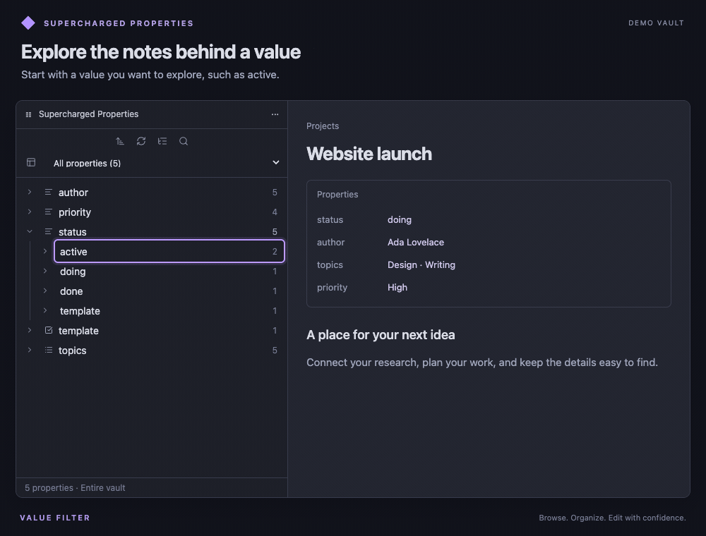
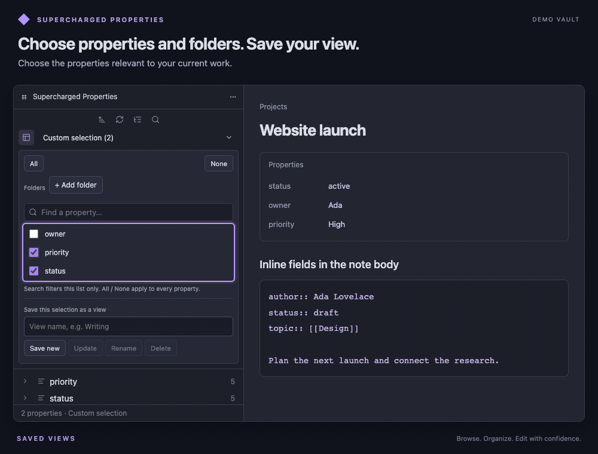
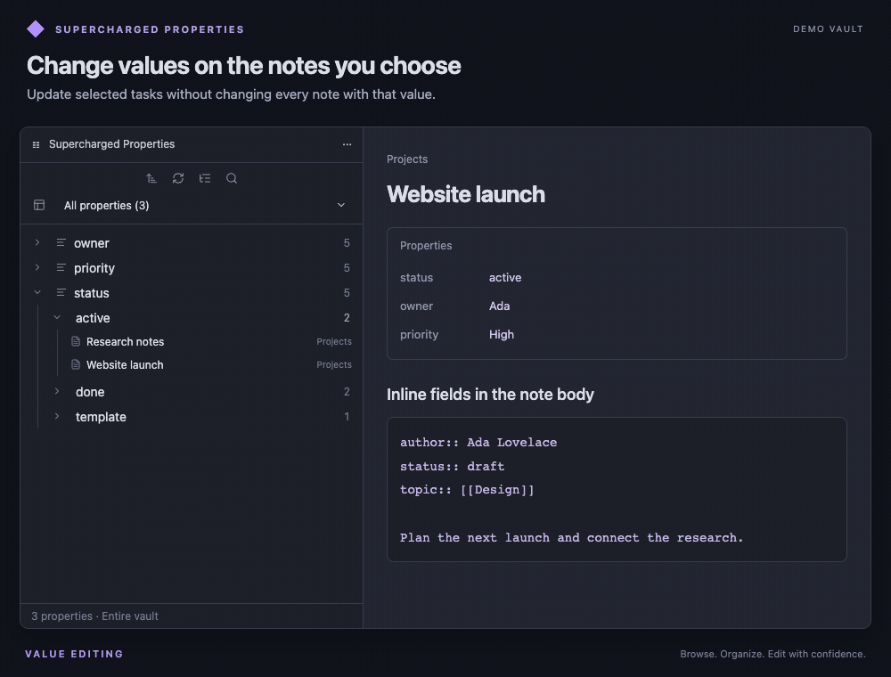

# Supercharged Properties

**Find the right notes. Keep your properties consistent.**

Your vault already knows which books you’re reading, which projects are active, and which notes belong to a topic. Supercharged Properties makes that information easy to explore: browse **properties → values → notes**, save views for different kinds of work, and clean up inconsistent metadata across many notes at once.

Go from “show me everything marked `active`” to the notes, authors, and topics behind that value. When it’s time to make changes, review exactly which notes will change before confirming, with session undo for the last successful batch.

[Get started](#get-started) · [User guide](docs/USER-GUIDE.md) · [Latest release](https://github.com/ajay126z/supercharged-properties/releases/latest)

## Find notes without remembering filenames

Start with what you know about a note - its status, author, rating, or topic. Expand a property to see its values, then open the notes that use them. Search property names, values, note names, or paths to find what you need.

## Explore notes sharing a value

**Use one shared value to explore and clean up the rest of a group’s metadata.**

Filter `status: active` to see which topics, authors, and other properties occur across your active notes. The tree and counts now describe that group, helping you spot inconsistent values or outdated fields without mixing in the rest of your vault.

For example, your active project notes might use both `topic: UX` and `topic: user experience`. Filter by `status: active`, then merge those topic values within the matching group. Notes outside that group are not part of the edit.

1. Right-click a value on desktop, or long-press on mobile, and choose **Filter by Value**.
2. Explore the remaining properties, or expand the note count to see the matching notes.
3. Rename or merge inconsistent values, or remove an outdated property from the group. Review the affected notes in the preview before confirming.
4. Choose **Clear** to return to the broader view; any folder filter remains active.

The Value filter narrows property-row and value-row edits to matching notes and combines with folder filters. You can also copy matching note links. **Open in Search** remains vault-wide, so use the local tree and edit preview when working within the group. [Value filtering and edit scope](docs/USER-GUIDE.md#value-filter).

## Build a view for the work in front of you

A reading list needs different fields from a project dashboard. Show the properties you need, limit the view to chosen folders, and save the combination for later.

- **Reading:** keep author, rating, and reading status together.
- **Projects:** focus on status and due dates in your Projects folder.
- **Daily notes:** browse only the fields and folders used by your journal.

Pin frequently used properties, hide distracting fields, and exclude template folders so they don’t inflate your results. Folder filters include subfolders and can be saved with both YAML and Inline views. Temporary value filters let you explore within a view without changing its saved selection.

[Save your first view](docs/USER-GUIDE.md#save-and-manage-views) · [Exclude templates](docs/USER-GUIDE.md#exclude-template-or-other-folders)

## Clean up metadata without opening every note

Small inconsistencies accumulate. Fix them across matching notes with a before/after preview.

| What you want to fix                          | What you can do                                      |
| --------------------------------------------- | ---------------------------------------------------- |
| `doing` and `in-progress` mean the same thing | Merge them into `active`.                            |
| An author is stored as plain text             | Convert `Ada Lovelace` into `[[Ada Lovelace]]`.      |
| A property name needs to change               | Rename `author` to `authors`, keeping its values.    |
| A text field contains several items           | Split `research, writing, editing` into a YAML list. |
| Old metadata is no longer useful              | Delete a property or selected values.                |

**See the affected notes before you confirm.** Conflict checks skip incompatible changes or values edited since the preview. Browsing, filtering, and organizing views never modify notes.

Use **Undo last property edit** to restore the last eligible YAML batch during the session. A later successful batch replaces it, and reloading clears it. Undo skips conflicting later edits; YAML comments and quoting may not restore exactly. Split into list is available only for Text properties. [Bulk-editing guide and safeguards](docs/BULK-EDITING.md).

Folder and Value filters narrow row-edit batches. In the upcoming version, tree search also narrows **Delete property** and tree **Add/Remove properties** actions; other row edits keep their full Folder/Value-filtered scope. Always check the preview’s note list.

## Update just the notes you choose

Move selected tasks from `todo` and `active` to `closed`, rate several books, or add a list value to a group of notes—all under the same property.

Right-click a note, or long-press on mobile, and choose **Change status…** (the action uses your property’s name). For several notes, choose **Select notes…**, make your selection, and use the selection bar. Desktop selection also supports Alt/Option-click and Shift-click, with checkboxes showing what is selected.

Text, numbers, checkboxes, dates, and date-and-time properties support typed changes. Lists support adding or removing items. You can keep a property empty or remove its key entirely. Review the preview before applying.

[Selected-note editing: types, selection, and undo](docs/NOTE-VALUE-EDITING.md)

## Bring inline fields into the same workflow

Already use fields such as `author:: AJ` or `[topic:: design]` in your note bodies? Turn on **Show inline properties** to browse them in a separate tree—no Dataview installation required.

Save Inline views, filter by value, and rename, replace, or delete inline fields with previews and their own session undo. When you want those fields in Obsidian’s Properties view or Bases, **Convert to YAML property…** lets you move or copy them into frontmatter, review conflicts, and confirm the changes.

[Inline properties](docs/USER-GUIDE.md#inline-properties) · [Convert inline fields to YAML](docs/BULK-EDITING.md#convert-inline-properties-to-yaml)

## More control over your workspace

These additions are **upcoming** and are not yet in the published 1.5.1 release. [See all upcoming changes](docs/releases/UNRELEASED.md).

- **Add or remove properties across folders.** Add up to 20 typed properties together, or remove whole keys, from an Explorer folder, multi-selection, or YAML row. Reuse existing names and values, preview each note, and choose how to handle existing values. [Batch-property guide](docs/ADD-REMOVE-PROPERTIES.md).
- **Keep properties in your own order.** Choose **Manual** to restore a view’s saved arrangement. Open **Reorder properties…** to use drag handles, menu moves, or keyboard controls. Done keeps the arrangement; Cancel restores the previous automatic sort and discards the session’s moves. [Manual ordering](docs/USER-GUIDE.md#reorder-properties-manually).
- **See folder sizes at a glance.** Optional File explorer badges show note counts for each folder, including subfolders if you choose. Include attachments or skip excluded folders to suit your workflow. [Folder counts](docs/USER-GUIDE.md#file-explorer-folder-counts).

## Get started

Works on **desktop and mobile**, with **Obsidian 1.7.2 or later**. Use right-click menus on desktop and long-press menus on mobile. Obsidian’s core Search plugin is needed only for **Open in Search**.

### Install

Open **Settings → Community plugins → Browse** and search for **Supercharged Properties**. If it is available there, install and enable it.

For manual installation, download `main.js`, `manifest.json`, and `styles.css` from the same [release](https://github.com/ajay126z/supercharged-properties/releases). Place them in `<YourVault>/.obsidian/plugins/supercharged-properties/`, reload Obsidian, and enable the plugin.

### Try your first view

1. Click the ribbon icon or run **Supercharged Properties: Open sidebar** from the command palette.
2. Expand a property you use often, then expand a value to see its notes.
3. Right-click or long-press a value and choose **Filter by Value** to explore that group.
4. Open **Choose properties to show**, select useful fields and optional folders, enter a view name, and choose **Save new**.

Saved views keep your property and folder selection; the temporary Value filter is not saved. To work in a full tab instead, run **Supercharged Properties: Open in tab**.

[Full user guide](docs/USER-GUIDE.md) · [Settings and commands](docs/USER-GUIDE.md#settings-and-commands) · [Troubleshooting](docs/USER-GUIDE.md#troubleshooting)

## Your notes stay in your vault

The plugin does not send vault data to external services or read your clipboard. Copy actions write only the query or note links you choose. Changes to notes require preview and confirmation; browsing and view customization change only plugin preferences.

## Help and support

- [Documentation index](docs/README.md) — guides for browsing, editing, filtering, and organizing.
- [Changelog](CHANGELOG.md) — changes by version.
- [Report an issue](https://github.com/ajay126z/supercharged-properties/issues) — include the steps to reproduce it and your Obsidian/plugin versions.

If Supercharged Properties saves you time, you can [support its development with a coffee](https://www.buymeacoffee.com/ajayzapadiya).

Value filtering was inspired by [RedPandaLi](https://github.com/RedPandaLi)’s Scoped Properties idea.

## Contributing and license

See [Contributing](CONTRIBUTING.md) for source builds and development instructions, and the [release runbook](docs/RELEASING.md) for publishing.

Copyright (c) 2026 Ajay Zapadiya. Released under the [MIT License](LICENSE). See [NOTICE.md](NOTICE.md) for third-party notices.

Supercharged Properties is an independent community plugin and is not affiliated with or endorsed by Obsidian. Obsidian is a trademark of Dynalist Inc.
