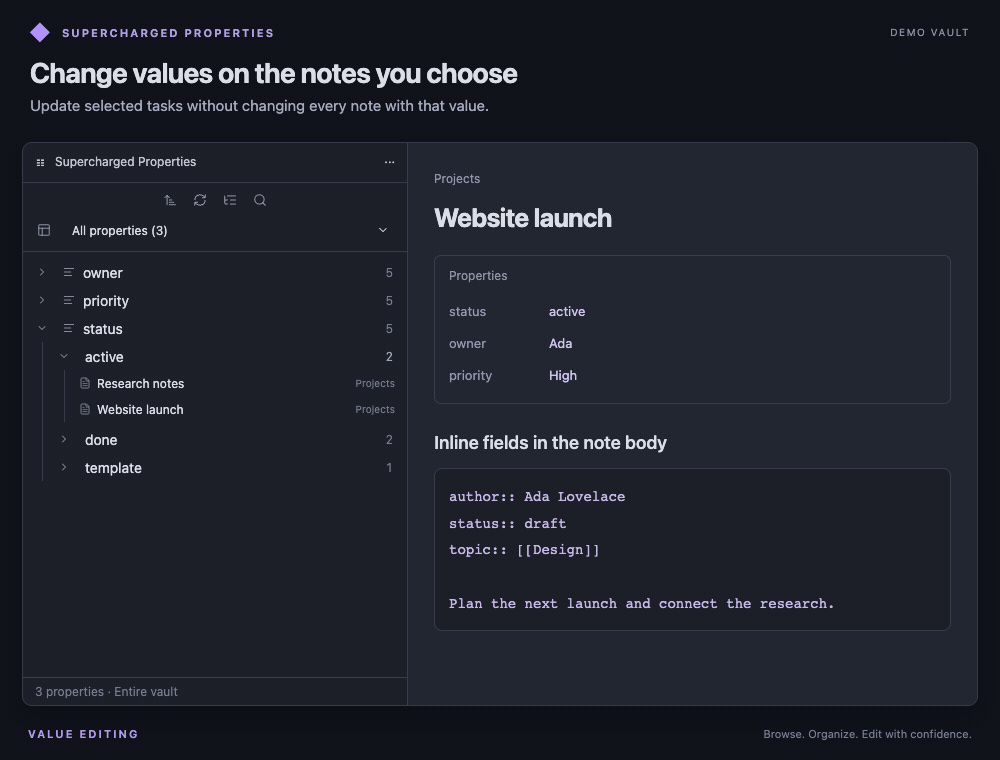

# Change a property on selected notes

Use note-row actions to edit one property on one or more notes. For example, move selected notes from `status: todo` and `status: active` to `status: closed` without changing every note that uses those values.

Selected-note editing is available in **1.3.0**. It shares the preview, confirmation, and session-scoped undo used by other property edits.

## Change one note

1. Expand a property and one of its values to show the notes.
2. **Desktop:** right-click a note. **Mobile:** long-press the note. With keyboard focus on the note, press **Shift+F10** or the context-menu key.
3. Choose **Change status…** (the menu uses the parent property's name).
4. For scalar properties, choose an existing value, enter a new typed value, choose **Set empty (keep property)**, or choose **Remove property**. For a List property, choose **Add values**, **Remove values**, or **Remove property**.
5. Review each affected path and its before/after values, plus any skipped notes.
6. Press **Apply to N notes** to confirm a value change, or **Remove property from N notes** to confirm whole-property removal.

The property is fixed to the note's parent property in this view. Opening the menu under `status` changes only `status`; other properties and the note body are preserved. Suggestions come only from that property's indexed values in included folders. Adding a new value changes the selected notes and makes the new value appear in the tree.

On mobile, the dialog uses the available screen height with a scrollable value picker and preview. Cancel and Apply stay visible above the on-screen keyboard, and the dialog expands again when the keyboard closes.

A normal desktop click opens the note and clears multi-selection. A normal mobile tap opens the note outside selection mode. Scrolling cancels a pending long-press. A completed long-press opens the menu without opening the note.

## Change multiple notes

Selection stays within one property. Selection mode shows checkboxes beside notes on both desktop and mobile, with selected rows highlighted. Click a checkbox to toggle a note without opening it; Shift-click a checkbox to add a range. Desktop row clicks retain the shortcuts below.

| Desktop interaction | Behavior |
| --- | --- |
| Alt-click (Windows/Linux) or Option-click (macOS) | Toggle individual notes without opening them. |
| Shift-click | Add the displayed range from the starting note to the selection. Existing selected notes remain selected. |
| Plain click | Open the note and clear the multi-selection. |
| Ctrl/Cmd-click | Open the note in a new tab and clear the multi-selection. |
| Up/Down | Move keyboard focus between displayed notes within the property. |
| Shift+Up/Down | Move focus and add both notes to the selection. |
| Escape | Clear the multi-selection. |

Click a note to establish a starting point, then Shift-click another to add the range. Alt/Option-selecting a note also establishes a new starting point. Repeated Shift-clicks add ranges; moving back does not deselect notes. Use Alt/Option-click to remove individual notes, or a plain click, Escape, or **Cancel** to clear the selection. This follows Obsidian's selection modifiers; see the [File explorer documentation](https://obsidian.md/help/plugins/file-explorer).

Only currently displayed rows participate: collapsed branches and notes behind **Show more notes** are not included. If there is no starting point in the displayed rows of that property, Shift-click selects just the clicked note and makes it the starting point. Changing the search or property scope, or canceling selection, resets the starting point. Selection never crosses into another property.

On mobile:

1. Long-press a note and choose **Select notes…**. That note is selected initially.
2. Tap checkboxes or note rows to toggle additional notes. You can expand other value groups within the property.
3. Tap **Change status…** in the selection bar, choose a destination, review the preview, and confirm.

Desktop users can also start with **Select notes…** in the right-click menu, then use the checkboxes, Alt/Option-click, or Shift-click. Each path is edited once. Right-clicking or long-pressing a selected note uses the selection; opening the menu on an unselected note targets that note alone. Choosing **Select notes…** starts a new selection with that note.

**Cancel** exits selection mode. Changing the tree search, search mode, property scope, hidden properties, or folder exclusions clears the selection. Deleted or moved paths are removed from selection when the index refreshes. Collapsing a branch keeps its selected notes, which remain included in the selection-bar count. Finishing an edit exits selection mode; canceling its dialog keeps the selection.

## Supported property types

The dialog follows the property's configured type. It does not change the type assigned in Obsidian.

| Property type | Controls and stored result |
| --- | --- |
| Text | Choose existing text or enter new text. Numeric-looking text remains a string. |
| Number | Choose an existing number or enter an integer/decimal, including negatives and scientific notation. Values are stored as YAML numbers. Blank input, expressions, non-finite values, and integers outside JavaScript's safe range are rejected. |
| Checkbox / boolean | Explicitly choose True (checked), False (unchecked), or Set empty. Values are stored as booleans, not the strings `"true"` or `"false"`. |
| Date | Choose an existing valid date or use the date picker. Dates are stored as `YYYY-MM-DD`; impossible dates are rejected. |
| Date & time | Choose an existing valid local timestamp or use the date/time picker. Values use `YYYY-MM-DDTHH:mm`, optionally with seconds and milliseconds. No timezone conversion is performed. |
| List | Add or remove multiple text/number items while preserving the other items. See below. |
| aliases / cssclasses | Add or remove text list items. |
| tags | Selected-note editing remains unavailable for this special property. |

For scalar properties, **Set empty** writes `null` and keeps the key. **Remove property** deletes the key and its entire value from only the selected notes. Literal text `empty` is a string, not null. Number and checkbox properties must contain their corresponding scalar type or an empty value; a numeric-looking string is not silently converted into a number. Text and date properties accept stored strings or empty values. Empty strings are also eligible. Missing properties, lists under scalar properties, and objects are skipped.

## Examples of typed edits

Select notes under the property you want to change, then use its **Change…** action:

| Task | Choice | Result on each selected eligible note |
| --- | --- | --- |
| Set an estimate | Under Number property `estimate`, enter `2.5`. | `estimate: 2.5` |
| Mark tasks complete | Under Checkbox property `complete`, choose True. | `complete: true` |
| Set a due date | Under Date property `due`, choose November 20, 2026. | `due: 2026-11-20` |
| Schedule a local time | Under Date & time property `scheduled`, choose November 20, 2026 at 09:30. | `scheduled: 2026-11-20T09:30` |
| Clear a status | Under Text property `status`, choose Set empty (keep property). | `status: null` |
| Remove a status | Under `status`, choose Remove property. | The `status` field is absent. |

These examples show the resulting values; Obsidian may format or quote YAML differently. Setting a scalar replaces its existing value. List additions and removals work on each note's own list, so notes can keep different remaining items.

## Add or remove list values

1. Open **Change topics…** on a note under a List property, or select several notes and open the action from the selection bar.
2. Choose **Add values** or **Remove values** to edit individual items. Choose **Remove property** to delete the entire key and list instead.
3. Check one or more **Existing list values**, enter **Values, one per line**, or combine both. Existing items show whether they are text or numbers.
4. For entered values, choose **Text** or **Number**. The type control is hidden for aliases and cssclasses, which require text.
5. Review each note's complete before/after list, then confirm.

Each nonblank input line represents one item; surrounding whitespace is trimmed. Commas remain part of text. Complete wikilinks such as `[[Project A]]` are text items. Duplicate requested items are processed once.

- **Add** appends missing items in the requested order and leaves existing items, duplicates, and their order intact.
- **Remove** deletes every exact match and preserves the order of remaining items. Matching is case-sensitive and type-sensitive: `"1"` and `1` are different items, as are `"Active"` and `"active"`.
- Removing the final item with **Remove values** writes `[]`; it does not delete the property key. Use **Remove property** when you want the key deleted.
- Adding to null or an empty string initializes a list. Removing from an empty value is a no-op.
- Flat lists of strings and finite numbers are supported. Nested lists, objects, boolean/null list entries, and scalar nonempty values under a List property are skipped. Existing numeric entries under aliases/cssclasses are also skipped.

For example, adding `review` to `[work, draft]` and `[personal]` produces `[work, draft, review]` and `[personal, review]`. Removing `draft` from those notes leaves `[work, review]` and `[personal, review]`.

A note already containing the scalar destination, all requested additions, or none of the requested removals is counted as unchanged. No-change previews cannot be applied.

## Remove the property from selected notes

Choose **Remove property** in the scalar destination picker or List operation picker. The preview lists the entire stored value as **(property removed)** and explains that all values under that key will be deleted. Confirm with **Remove property from N notes**; opening the dialog or choosing the option does not write anything.

| Current value | Set empty / Remove values | Remove property |
| --- | --- | --- |
| Text, Number, Checkbox, Date, Date & time | Set empty retains the key with `null`. | Deletes the key and value. |
| Empty scalar (`null` or empty text) | Set empty keeps the key. | Deletes the key. |
| List with one item | Removing that item leaves `[]`. | Deletes the key and item. |
| List with multiple items | Removes only the requested items. | Deletes the key and every item. |
| Empty list (`[]`) | Removing items makes no change. | Deletes the key. |

Whole-property removal also works when the stored value does not match its configured supported type, since it removes the whole field rather than converting its contents. This includes lists containing nested/object values that cannot be edited item by item. Unknown configured property types and tags remain outside this selected-note action.

Only selected notes are affected. Other properties, the note body, saved views, and pins are retained. A single key spelled `Status` is removed and restored with that exact spelling. Notes containing both `status` and `Status` are skipped as ambiguous. If a key with the same normalized name is recreated after deletion, undo skips it rather than overwriting it; after resolving that conflict, undo can be retried.

## Safeguards and undo

Only explicitly selected note paths are considered. With an active [Value filter](USER-GUIDE.md#value-filter), note selection and suggested values stay within its subset. Applying or clearing a Value filter clears note selection. Excluded folders, unavailable notes, missing properties, unsupported values, and ambiguous spellings such as both `status` and `Status` are reported in the preview. Before writing, the plugin rechecks exclusions, the configured type, the exact original value, and property-name ambiguity. Changes since preview are skipped.

Successful writes can coexist with skipped notes or failures; the completion notice reports the counts and path-specific failures. The tree refreshes after the operation. Saved views, pins, selections of properties, and hiding preferences are preserved.

Run **Supercharged Properties: Undo last property edit** to restore successful changes. Later edits to the affected property are skipped. A batch with no successful writes preserves the previous undo batch. A successful new edit replaces it, and reload, disable, or restart clears it. Undo restores values rather than YAML formatting or comments. Notes moved or deleted after the edit cannot be restored through their old paths.

See also [bulk value editing](BULK-EDITING.md) for actions that affect all matching values, and [property-name editing](PROPERTY-RENAMING.md) for renaming or deleting keys.
